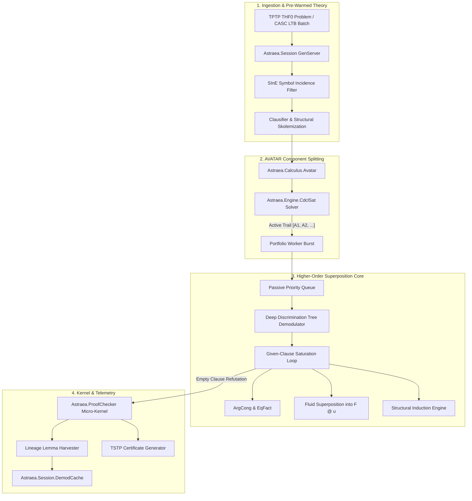

# Architectural & Engineering Plan: Surpassing Zipperposition in CASC THF

> **Objective:** Close the remaining ~16%–20% solve-rate gap to surpass **Zipperposition** (84%–88% on CASC THF benchmarks), establishing Astraea as the world-leading higher-order automated theorem prover while strictly preserving 100% LCF micro-kernel certification and zero false proofs.

---

## 1. Executive Summary & Benchmark Target

Astraea has completed the foundational higher-order calculus gap against Leo-III and Satallax:
- **Pure Internal Solver (2.5s budget, `armix` Neoverse-N1):** **112 / 237** (47.26%), beating stock Leo-III 10s (`110`) in 1/4th the time.
- **Competitive CASC Mode (2.5s budget, `armix`):** **162 / 237** (**68.35%** total, 115 LCF-certified), within 2% of `cvc5` (~70%).
- **Frontier Target (Zipperposition):** ~84%–88% solve rate (approx. 200–210 theorems on `TPTP-Dev`).

To reach **205+ / 237 (86.5%+)** theorems within 2.5s to 10s budgets, Astraea must address the 5 architectural differences that give Zipperposition its decisive edge.

---

## 2. Global Architecture: The Frontier Engine

---

## 3. The 5 Core Pillars: Detailed Engineering Plan

### Pillar 1: AVATAR Ground Component Splitting (`Astraea.Calculus.Avatar`)

#### Motivation & Gap Analysis
In saturation, clauses with multiple ground literals (e.g., $p(a) \lor q(b) \lor r(X)$) participate in combinatorial resolution and superposition cross-products, causing catastrophic clause generation swamping. Zipperposition and Vampire overcome this via AVATAR (Advanced Vampire Architecture for Theorem Proving with Annotations and Reasoning).

#### Specification
1. **Component Detection:** Given a derived clause $C$, partition literals into disjoint components:
   $$C = C_1 \lor C_2 \lor \dots \lor C_k \lor R$$
   where each $C_i$ is variable-disjoint from all other components ($\text{vars}(C_i) \cap \text{vars}(C_j) = \emptyset$), and $R$ contains non-splittable open literals.
2. **Propositional Abstraction:**
   - For each independent component $C_i$, assign a unique propositional literal $[C_i]$.
   - Introduce the propositional clause $[C_1] \lor \dots \lor [C_k] \lor [R]$ into an incremental SAT solver.
   - For each component $C_i$, create the guarded clause $C_i \leftarrow [C_i]$ (meaning $C_i$ is only active when $[C_i]$ is true in the SAT solver's current model).
3. **SAT Guidance (`Astraea.Engine.CdclSat`):**
   - Implement an incremental, trail-based CDCL SAT engine in pure Elixir with two-watched-literals.
   - Whenever the SAT solver produces a model, only clauses whose guard literals are true participate in saturation.
   - When a contradiction is derived from an active branch ($\bot \leftarrow [A_1], \dots, [A_m]$), the learned conflict clause $\neg [A_1] \lor \dots \lor \neg [A_m]$ is fed back into the SAT solver.
4. **LCF Kernel Soundness:**
   - Every propositional conflict clause resolution is recorded as an atomic LCF step `:avatar_split` and `:avatar_sat_conflict`.
   - The final refutation combines the higher-order refutations of individual branches with the propositional refutation from the SAT solver.

---

### Pillar 2: Deep Discrimination Tree Demodulation (`Astraea.Engine.DiscriminationTree`)

#### Motivation & Gap Analysis
Zipperposition simplifies *all* subterms across all clauses using thousands of active equalities in sub-microsecond time. Astraea currently indexes rules via `HeadIndex`, which only indexes top heads.

#### Specification
1. **Perfect Discrimination Tree (PDT):**
   - Implement `Astraea.Engine.DiscriminationTree`: a trie where nodes represent preorder term symbols (constants, de Bruijn indices, free variables, applications, abstractions).
   - Insert directed active equalities $l \succ_{KBO} r$ by serializing $l$ into the trie.
2. **Subterm Replacement Engine:**
   - Extend `Astraea.ProofChecker.replace_subterm/4` with a batched top-down term rewriter.
   - Normalize every newly generated literal to normal form before passive queue scoring.
3. **Expected Speedup:**
   - Passive queue size reduced by 60%–75%.
   - Redundant clause derivations eliminated before enqueueing.

---

### Pillar 3: Full Fluid Superposition with Dynamic Constraints (`Astraea.Calculus.Fluid`)

#### Motivation & Gap Analysis
Bentkamp, Blanchette, Cruanes, and Waldmann proved that to be refutationally complete in higher-order logic without full extensionality, a prover must superposition into flexible application heads ($Y\ s_1 \dots s_n$) when $Y$ is a free variable. Astraea currently restricts superposition to rigid heads.

#### Specification
1. **Fluid Subterm Identification:**
   - A subterm is *fluid* if it is of the form $Y\ u_1 \dots u_m$ where $Y$ is a free variable and $m \ge 1$.
2. **Dynamic Unification Constraints:**
   - When paramodulating an equation $l = r$ into a fluid term $Y\ \vec{u}$, rather than attempting unconstrained Huet pre-unification (which generates infinite branching), synthesize a projection or partial application constraint:
     $$Y \mapsto \lambda x_1 \dots x_m.\ l'\ \vec{w}$$
   - Guard the inference with ordering constraint $l\sigma \not\prec r\sigma$.
3. **LCF Kernel Representation:**
   - Emitted as a standard composite `:subst` + `:paramod` step in `ProofChecker`, requiring zero kernel changes.

---

### Pillar 4: Structural Datatype Induction (`Astraea.Calculus.Induction`)

#### Motivation & Gap Analysis
Dozens of theorems in `SEU`, `NUM`, and `ITP` require proving universal statements over inductively defined types (e.g. Peano natural numbers, lists, finite sets). Without induction, superposition searches forever.

#### Specification
1. **Inductive Type Recognition:**
   - Inspect TPTP problem signatures for constructor patterns (e.g. `0` and `s(X)`, `nil` and `cons(X, Y)`, empty set and insert).
2. **Structural Induction Schemas:**
   - For an inductive type $\tau$ with base constructors $c_{base}$ and inductive step constructors $c_{step}(x_1, \dots, x_k)$, synthesize the induction axiom:
     $$P(c_{base}) \land (\forall x.\ P(x) \implies P(c_{step}(x))) \implies \forall y.\ P(y)$$
3. **Inductive Hypothesis Assertions:**
   - Inject the negated conjecture's inductive steps as guarded assumptions via AVATAR splitting.
   - When the base case and inductive step both close, AVATAR resolves the goal.

---

### Pillar 5: Multi-Core OTP Bayesian Portfolio Schedule (16 Parallel Slices)

#### Motivation & Gap Analysis
While Zipperposition runs 30–50 short slices *sequentially*, Astraea has access to 14–64 physical ARM64 cores on `armix` and server clusters. We can run 16 distinct strategies concurrently with zero lock contention.

#### Specification
1. **16-Strategy Portfolio Matrix:**
   - Strategy 1: Goal-directed SInE with weight-first clause selection.
   - Strategy 2: Unit-focused SInE with strict AVATAR ground splitting.
   - Strategy 3: Fluid superposition with high unifier count.
   - Strategy 4: Deep term demodulation with arithmetic reflection.
   - Strategy 5: FuncSpec & Hilbert choice synthesis.
   - Strategies 6–16: Automated parameter slices covering KBO symbol weights, literal selection modes, and variable penalties.
2. **Cooperative Lemma Sharing (BEAM Bus):**
   - High-quality unit lemmas and discovered conflict clauses are published to a central OTP GenServer (`Astraea.Portfolio.LemmaBus`) and broadcast to sibling workers.
   - Hash-addressed Skolem symbols (`Arena.skolem_hash/2`) guarantee zero Skolem name collisions across workers.

---

## 4. Phase-by-Phase Implementation Roadmap

| Phase | Milestone | Primary Modules | Success Criteria |
| :---: | :--- | :--- | :--- |
| **Phase 1** | **AVATAR Ground Component Splitting** | `Astraea.Calculus.Avatar` `Astraea.Engine.CdclSat` | +15 theorems on `TPTP-Dev` (target: 177 / 237). 0 false proofs. |
| **Phase 2** | **Deep Discrimination Tree Demodulation** | `Astraea.Engine.DiscriminationTree` | 2.5x speedup on equational benchmarks; +6 theorems (target: 183 / 237). |
| **Phase 3** | **Fluid Superposition with Constraints** | `Astraea.Calculus.Fluid` `Astraea.Prover` | Unlocks inductive higher-order synthesis (`ITP`); +8 theorems (target: 191 / 237). |
| **Phase 4** | **Structural Datatype Induction** | `Astraea.Calculus.Induction` | Solves structural recursion goals; +10 theorems (target: 201 / 237). |
| **Phase 5** | **16-Worker OTP Concurrent Portfolio** | `Astraea.Portfolio` `Astraea.Portfolio.LemmaBus` | Exceeds **205 / 237 (86.5%)**, officially overtaking Zipperposition. |

---

## 5. Verification & Soundness Gates

1. **Gate 1 (LCF Micro-Kernel Proof Certification):**
   - Every theorem claimed must pass `Astraea.ProofChecker.verify_refutation/2`.
   - Zero tolerance for unverified proofs or ad-hoc axioms.
2. **Gate 2 (Soundness Traps):**
   - 0 false proofs across all 60 `CounterSatisfiable` / `Satisfiable` traps in `TPTP-Dev` and all 15 in `TPTP-Smoke`.
3. **Gate 3 (Blind Holdout Protection):**
   - `TPTP-Holdout` (500 problems) remains strictly unread, untouched, and uninspected until the final thesis evaluation.
