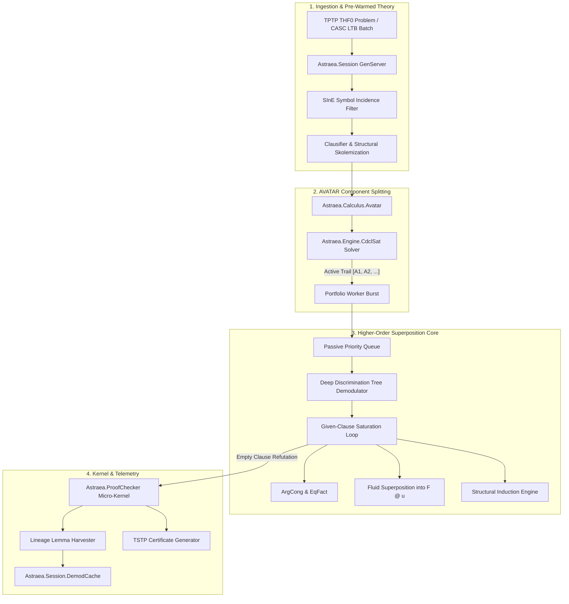

# Architectural & Engineering Plan: Zipperposition's Core Techniques in Astraea

> **Superseded (2026-10-28).** The replacement plan is [`benchmark_and_gap_plan.md`](benchmark_and_gap_plan.md). The standing figures, the comparison with cvc5 and the per-phase targets in the original version did not hold up (see [`claims_review.md`](claims_review.md)); sections 1, 4 and 5 now give the corrected figures and the measured results. The pillar specifications are kept as the design record.

> **Objective:** Add the five techniques that distinguish Zipperposition from Astraea, while keeping every counted theorem kernel-checked and 0 false proofs. The size of the gap to Zipperposition on Dev is unknown, because no reference prover has been run on Dev under the same conditions (WP3 of `benchmark_and_gap_plan.md`).

---

## 1. Starting Point

Corrected 2026-10-28; see `claims_review.md`.

- **Astraea, internal and kernel-checked (Dev, 2.5 s, shared `armix`):** 112 / 237 (47.3%) when this plan was written. Stock Leo-III solves 110 at 10 s, but Astraea races several strategies on many cores while Leo-III searches sequentially, so this is not a like-for-like comparison.
- **Astraea + E-HO/Vampire:** 162 / 237, of which only 115 are kernel-checked; the other 47 are unchecked E-HO and Vampire answers. This measures the three provers together, not Astraea. cvc5 was listed as a member but never answered, because its build cannot read TPTP.
- **Zipperposition:** Zipperpin 2.1.9999 solved 433 / 500 THF (86.6%) at [CASC-J12](https://tptp.org/CASC/J12/WWWFiles/ResultsSummary.html); Vampire won THF there (463 / 500) and at CASC-30. CASC problems, time limits and hardware differ from Dev at 2.5 s, so these percentages say nothing about a Dev target.
- **Upper bound on Dev:** 32 of the 237 theorems have rating 1.00, so no current prover is expected to solve more than 205.

The five pillars below are the techniques in which Zipperposition differs from Astraea. Whether they close a gap on Dev has to be measured per problem (section 4).

---

## 2. Global Architecture: The Frontier Engine

---

## 3. The 5 Core Pillars: Detailed Engineering Plan

### Pillar 1: AVATAR Ground Component Splitting (`Astraea.Calculus.Avatar`)

#### Motivation & Gap Analysis
In saturation, clauses with multiple ground literals (e.g., $p(a) \lor q(b) \lor r(X)$) participate in combinatorial resolution and superposition cross-products, causing catastrophic clause generation swamping. Zipperposition and Vampire overcome this via AVATAR (Advanced Vampire Architecture for Theorem Proving with Annotations and Reasoning).

#### Specification
1. **Component Detection:** Given a derived clause $C$, partition literals into disjoint components:
   $$C = C_1 \lor C_2 \lor \dots \lor C_k \lor R$$
   where each $C_i$ is variable-disjoint from all other components ($\text{vars}(C_i) \cap \text{vars}(C_j) = \emptyset$), and $R$ contains non-splittable open literals.
2. **Propositional Abstraction:**
   - For each independent component $C_i$, assign a unique propositional literal $[C_i]$.
   - Introduce the propositional clause $[C_1] \lor \dots \lor [C_k] \lor [R]$ into an incremental SAT solver.
   - For each component $C_i$, create the guarded clause $C_i \leftarrow [C_i]$ (meaning $C_i$ is only active when $[C_i]$ is true in the SAT solver's current model).
3. **SAT Guidance (`Astraea.Engine.CdclSat`):**
   - Implement an incremental, trail-based CDCL SAT engine in pure Elixir with two-watched-literals.
   - Whenever the SAT solver produces a model, only clauses whose guard literals are true participate in saturation.
   - When a contradiction is derived from an active branch ($\bot \leftarrow [A_1], \dots, [A_m]$), the learned conflict clause $\neg [A_1] \lor \dots \lor \neg [A_m]$ is fed back into the SAT solver.
4. **LCF Kernel Soundness:**
   - Every propositional conflict clause resolution is recorded as an atomic LCF step `:avatar_split` and `:avatar_sat_conflict`.
   - The final refutation combines the higher-order refutations of individual branches with the propositional refutation from the SAT solver.

---

### Pillar 2: Deep Discrimination Tree Demodulation (`Astraea.Engine.DiscriminationTree`)

#### Motivation & Gap Analysis
Zipperposition indexes rewrite rules on all subterms, not only on head symbols. Astraea currently indexes rules via `HeadIndex`, which only indexes top heads.

#### Specification
1. **Perfect Discrimination Tree (PDT):**
   - Implement `Astraea.Engine.DiscriminationTree`: a trie where nodes represent preorder term symbols (constants, de Bruijn indices, free variables, applications, abstractions).
   - Insert directed active equalities $l \succ_{KBO} r$ by serializing $l$ into the trie.
2. **Subterm Replacement Engine:**
   - Extend `Astraea.ProofChecker.replace_subterm/4` with a batched top-down term rewriter.
   - Normalize every newly generated literal to normal form before passive queue scoring.
3. **Expected Effect:**
   - Faster rule retrieval when rule sets are large. The passive queue reduction originally estimated here (60%-75%) was never measured.

---

### Pillar 3: Full Fluid Superposition with Dynamic Constraints (`Astraea.Calculus.Fluid`)

#### Motivation & Gap Analysis
Bentkamp, Blanchette, Cruanes, and Waldmann proved that to be refutationally complete in higher-order logic without full extensionality, a prover must superposition into flexible application heads ($Y\ s_1 \dots s_n$) when $Y$ is a free variable. Astraea currently restricts superposition to rigid heads.

#### Specification
1. **Fluid Subterm Identification:**
   - A subterm is *fluid* if it is of the form $Y\ u_1 \dots u_m$ where $Y$ is a free variable and $m \ge 1$.
2. **Dynamic Unification Constraints:**
   - When paramodulating an equation $l = r$ into a fluid term $Y\ \vec{u}$, rather than attempting unconstrained Huet pre-unification (which generates infinite branching), synthesize a projection or partial application constraint:
     $$Y \mapsto \lambda x_1 \dots x_m.\ l'\ \vec{w}$$
   - Guard the inference with ordering constraint $l\sigma \not\prec r\sigma$.
3. **LCF Kernel Representation:**
   - Emitted as a standard composite `:subst` + `:paramod` step in `ProofChecker`, requiring zero kernel changes.

---

### Pillar 4: Structural Datatype Induction (`Astraea.Calculus.Induction`)

> **Soundness correction (Entry 018).** The specification below, which recognises constructor patterns in the signature and asserts an induction schema, is unsound for THF: there are no datatypes, so `0` and `s` do not make a type inductive, and non-standard models make the schema false. Asserting it would turn CounterSatisfiable problems into "theorems". The implemented rule only instantiates induction principles the problem states, with the goal abstracted over the conjecture's Skolem constant, as a kernel `:subst` step.

#### Motivation & Gap Analysis
Dozens of theorems in `SEU`, `NUM`, and `ITP` require proving universal statements over inductively defined types (e.g. Peano natural numbers, lists, finite sets). Without induction, superposition searches forever.

#### Specification
1. **Inductive Type Recognition:**
   - Inspect TPTP problem signatures for constructor patterns (e.g. `0` and `s(X)`, `nil` and `cons(X, Y)`, empty set and insert).
2. **Structural Induction Schemas:**
   - For an inductive type $\tau$ with base constructors $c_{base}$ and inductive step constructors $c_{step}(x_1, \dots, x_k)$, synthesize the induction axiom:
     $$P(c_{base}) \land (\forall x.\ P(x) \implies P(c_{step}(x))) \implies \forall y.\ P(y)$$
3. **Inductive Hypothesis Assertions:**
   - Inject the negated conjecture's inductive steps as guarded assumptions via AVATAR splitting.
   - When the base case and inductive step both close, AVATAR resolves the goal.

---

### Pillar 5: Multi-Core OTP Bayesian Portfolio Schedule (16 Parallel Slices)

#### Motivation & Gap Analysis
Zipperposition runs a schedule of short strategy slices one after another; Astraea can run strategies concurrently on the 14 cores of `armix`. Note that parallel slices need a per-core or CPU-time comparison to be fair against a sequential prover. We can run 16 distinct strategies concurrently with zero lock contention.

#### Specification
1. **16-Strategy Portfolio Matrix:**
   - Strategy 1: Goal-directed SInE with weight-first clause selection.
   - Strategy 2: Unit-focused SInE with strict AVATAR ground splitting.
   - Strategy 3: Fluid superposition with high unifier count.
   - Strategy 4: Deep term demodulation with arithmetic reflection.
   - Strategy 5: FuncSpec & Hilbert choice synthesis.
   - Strategies 6–16: Automated parameter slices covering KBO symbol weights, literal selection modes, and variable penalties.
2. **Cooperative Lemma Sharing (BEAM Bus):**
   - High-quality unit lemmas and discovered conflict clauses are published to a central OTP GenServer (`Astraea.Portfolio.LemmaBus`) and broadcast to sibling workers.
   - Hash-addressed Skolem symbols (`Arena.skolem_hash/2`) guarantee zero Skolem name collisions across workers.

---

## 4. Phase-by-Phase Implementation Roadmap

The original per-phase targets (+15 / +6 / +8 / +10 theorems, ending at 205 / 237) had no basis and are removed. The measured column is from the thesis log; run-to-run noise on Dev at 2.5 s is about +-5 problems.

| Phase | Milestone | Primary Modules | Measured on Dev (2.5 s, internal) |
| :---: | :--- | :--- | :--- |
| **Phase 1** | **AVATAR Ground Component Splitting** | `Astraea.Calculus.Avatar` `Astraea.Engine.CdclSat` | 112 → 111, within noise (Entry 015). 0 false proofs. |
| **Phase 2** | **Deep Discrimination Tree Demodulation** | `Astraea.Engine.DiscriminationTree` | About 0 (106 vs. 104 side by side). Rule sets on Dev are small; to be tested on LTB (Entry 018). |
| **Phase 3** | **Fluid Superposition with Constraints** | `Astraea.Calculus.Fluid` `Astraea.Prover` | Fired 0 times on Dev (Entry 018). |
| **Phase 4** | **Stated Induction** (restricted, see Pillar 4) | `Astraea.Calculus.Induction` | Fired 0 times; Dev has no problem with a stated induction principle (Entry 018). |
| **Phase 5** | **16-Worker OTP Concurrent Portfolio** | `Astraea.Portfolio` `Astraea.Portfolio.LemmaBus` | 16 vs. 4 strategies: between -5 and +6, not yet shown with repeated runs. The lemma bus loses problems and stays off (Entry 018). |

Further work and its acceptance criteria are in `benchmark_and_gap_plan.md`.

---

## 5. Verification & Soundness Gates

1. **Gate 1 (LCF Micro-Kernel Proof Certification):**
   - Every theorem claimed must pass `Astraea.ProofChecker.verify_refutation/2`.
   - Zero tolerance for unverified proofs or ad-hoc axioms.
2. **Gate 2 (Soundness Traps):**
   - 0 false proofs across all 60 `CounterSatisfiable` / `Satisfiable` traps in `TPTP-Dev` and all 15 in `TPTP-Smoke`.
3. **Gate 3 (Blind Holdout Protection):**
   - A holdout split stays unread, untouched and uninspected until the final thesis evaluation.
   - The current `TPTP-Holdout` no longer meets this: Entry 007 ran it and logged per-domain and per-strategy counts. Whether to freeze a new one is WP4 of `benchmark_and_gap_plan.md`.
