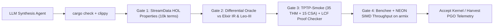

# TPTP Test, Soundness & Evaluation Plan (Astraea on `armix` & HPC)

**Target Corpus:** `TPTP-v9.3.1` (released Aug 21, 2026) + `BuggedProblems-v9.3.1.txt`  
**Primary Synthesis & CI Node:** `armix` (`aarch64` 14-core Neoverse-N1, 31 GiB RAM, OTP 27 JIT, Rust 1.97.1, `z3`/`cvc5`/`bitwuzla`/`yices`)  
**Large-Scale Ablation Cluster:** `zib` (`bgnlogin1.nhr.zib.de`, NHR@ZIB HPC)  
**Repository Fork:** `marcnnn/Leo-III-1` (`armix:~/Projects/opensource/Leo-III`, branch `astraea`)

---

## 1. Infrastructure & Storage Constraints on `armix`

Probing `armix` revealed two key operational parameters that shape the test setup:

1. **Compute & Native Toolchains Ready:**
   * **CPU / Memory:** 14 physical ARM64 Neoverse-N1 cores (1 thread/core, zero hyperthreading jitter — ideal for deterministic benchmarking and ARM NEON / `std::simd` vectorization) with 31 GiB RAM (~25 GiB available).
   * **Runtimes:** Erlang/OTP 27 (`[jit] [smp:14:14]`), Elixir (`mix`), Rust `1.97.1` (`cargo`/`rustc`), Python `3.12.3`.
   * **Pre-Installed External Solvers:** `/home/marc/tools/oss-cad-suite/bin/{z3,cvc5,bitwuzla,boolector,yices}` are already present on `armix` for SMT/FOF cross-verification.
   * **Reference Leo-III Oracle:** Stock `leo3-v1.7.18.jar` (from `leoprover/Leo-III` releases) or local `sbt assembly` jar (requires OpenJDK 21 via `dnf` or `asdf` on `armix`) serves as the differential HOL oracle.
2. **Disk Headroom Protection (`/` at 16 GiB free):**
   * Unpacking the full `TPTP-v9.3.1.tgz` (893 MB compressed $\to$ **10.5 GB** across CNF/FOF/TFF/THF) onto `armix` would consume >70% of remaining `/` free space (note: `vda3` LUKS container has ~1 TB unallocated LVM extents if needed later, but we stay lean by default).
   * **Solution — Streaming THF-Slice Extraction:** `scripts/tptp_thf0_setup.py` streams `TPTP-v9.3.1.tgz` over HTTP directly into `tar`, extracting **only** `Problems/*/*^*.p` (higher-order THF problems) and `Axioms/*` into `~/.cache/tptp/TPTP-v9.3.1`, keeping disk footprint under **~350 MB** with zero temporary tarball on disk.

---

## 2. Strict THF0 Filtering & Corpus Hygiene

Not every `^` file in TPTP is monomorphic classical HOL (THF0). Following `Notes/master_thesis_proposal.md` Section 5, `scripts/tptp_thf0_setup.py` scans every `Problems/*/*^*.p` (and transitively included `Axioms/*.ax`) and enforces four hygiene filters:

1. **Official Bug Exclusion:** Drop any problem listed in `BuggedProblems-v9.3.1.txt` (e.g., `SYN000^2`, `ITP115^4..7`, `ITP122^4..7`, `ITP125^4..7`).
2. **Monomorphic THF0 Syntax Gate:**
   * **Include:** Base types (`$i`, `$o`, user `$tType` declarations), function types (`>`), `@` application, `^` $\lambda$-abstraction, `!` / `?` quantifiers, `=` / `!=`, standard Boolean connectives, and `$ite` / `$let` (only after lowering pass is enabled; tagged separately in manifest).
   * **Exclude (Out-of-Scope Extensions):**
     * Polymorphic TH1 (`!>` type quantification, `$tType > ...` type constructors).
     * Interpreted arithmetic (`$int`, `$rat`, `$real`, `$sum`, `$product`, `$less`, ...).
     * Non-classical modal/deontic `$modal` logic specifications (`thf(..., logic, ...)`).
     * Choice operator `@+` / `@-` (tracked in a separate optional subset `thf0_choice` so core completeness/soundness tests don't conflate choice axioms).
3. **SZS Status Classification:**
   * **Provable (`THM-like`):** `Theorem`, `ContradictoryAxioms`
   * **Soundness Traps (`CSA-like`):** `CounterSatisfiable`, `Satisfiable`
   * **Unresolved (`OPEN`):** `Open`, `Unknown` (excluded from automated pass/fail gates; reserved for exploratory discovery)
4. **Elixir Parser Compatibility:** In Elixir, we parse TPTP files via `{:tptp, "~> 0.3.0"}` (Johannes Schuster's BNF-generated span-carrying TPTP parser/printer on Hex.pm) and lower ASTs into the flat `u32` Arena IR.

---

## 3. Anti-Leakage 4-Tier Split & Symbol Anonymization

To ensure scientific rigor (preventing LLM benchmark memorization and cross-run overfitting while enabling PGO and `PatternAntiUnification` / `CompressedRule` learning), the filtered THF0 corpus is partitioned deterministically (SHA-256 seed `'astraea-tptp-v9.3.1'`) into four disjoint tiers:

| Tier | Manifest | Target Size | Composition & SZS Balance | Timeout | Purpose & Access Policy |
| :--- | :--- | :---: | :--- | :---: | :--- |
| **Tier 0** | `Leo-Unit` | ~25 | Repo-local `src/test/resources/problems/{b_eta,b_f,boolext,ext_test,ext_test_2,norm1,res1,SYN000/*}.p` | 500 ms | Instant `<2s` sanity check on every `mix test` / `cargo test` run. |
| **Tier 1** | `TPTP-Smoke` | 50 | 35 `THM` (Rating `0.00–0.25`) + **15 `CSA`/`SAT` traps**, stratified across `SYO`, `SET`, `ALG`, `LCL`, `PUZ`, `SEU` | 1.0 s | **Gate 3 Inner Synthesis Gate:** Runs across all 14 `armix` cores in **~3.5s wall-clock** per LLM synthesis iteration. Any false proof on `CSA`/`SAT` is an immediate hard reject. |
| **Tier 2** | `TPTP-Dev` | 300 | 240 `THM` (Ratings `0.00–0.85`) + **60 `CSA`/`SAT` traps**, stratified by domain & axiom count | 10.0 s | **Harness Optimization & PGO Training:** Used for BEAM telemetry, `PatternAntiUnification` rule collapsing, watchlist harvesting, and KBO precedence tuning. **Anonymized before any LLM exposure.** |
| **Tier 3** | `TPTP-Holdout` | 500+ | 400 `THM` (Ratings `0.00–1.00`, incl. `ITP` Sledgehammer batch problems) + **100 `CSA`/`SAT` traps** | 60 s (CASC) | **Frozen Blind Thesis Benchmark:** SHA-256 locked. **Never** read by the synthesis agent or PGO cross-run learner; evaluated only for milestone & final thesis RQ1/RQ3 tables on `armix` / `zib`. |

### Mandatory Anonymization Preprocessor (`anonymize` mode)
Whenever a `TPTP-Smoke` or `TPTP-Dev` problem produces a failing counterexample or trace fed back to the LLM synthesis agent:
1. All `include('Axioms/...')` statements are recursively inlined.
2. All `%` comment headers (problem code, domain, rating, English description, SZS status, references) are stripped.
3. All user-defined type, constant, variable, and formula names (`thf(ax_1, axiom, ...)`) are deterministically renamed to opaque tokens (`ty_001`, `sym_001`, `V_001`, `f_0001`) using a salted per-run bijection.
4. Built-in TPTP symbols (`$i`, `$o`, `$true`, `$false`, `=`, `!`, `?`, `^`, `@`) remain intact so logical semantics and structural complexity are preserved identically while zero TPTP identity leaks into the prompt.

---

## 4. The 4-Gate Verification Pipeline on `armix`

Every native Rust/SIMD module synthesized or optimized on `armix` must pass four automated Elixir ExUnit / Mix gates sequentially (aborting early on failure to conserve Claude token quota):



### Gate 1 — Property-Based HOL Invariants (`StreamData`, < 3s)
* **Well-Typed Term & Arena Roundtrips:** `Elixir AST <-> Flat u32 Arena <-> Combinator (S,K,I,B,C) Arena` preserves exact types and $\beta\eta$-equivalence on ground/test applications.
* **Content-Addressed Skolem Determinism:** $\alpha$-equivalent quantified formulas in independent worker processes hash to the **exact same** 64-bit Skolem symbol ID; non-equivalent formulas never collide.
* **KBO Laws:** Irreflexivity ($\neg(s \succ s)$), asymmetry, transitivity ($s \succ t \land t \succ u \implies s \succ u$), subterm property, and substitution monotonicity ($s \succ t \implies s\sigma \succ t\sigma$).
* **Unification Soundness:** Every returned substitution $\sigma$ from pattern/bounded unification satisfies $\text{norm}(s\sigma) \equiv_{\alpha} \text{norm}(t\sigma)$ and preserves types.

### Gate 2 — Differential Oracle Gate (< 5s)
* Compares Rust NIF outputs bit-for-bit / canonical-form-for-canonical-form against:
  1. **Layer 2 Pure Elixir Reference Interpreter** (on 2,000 generated `StreamData` terms + `Tier 0 Leo-Unit`).
  2. **Stock Leo-III (`leo3`) + `cvc5`:** Cross-checks SZS status compatibility using the exact lattice from [`contrib/crossverify_starexec`](file:///Users/marcnickert/Projects/opensource/Leo-III/contrib/crossverify_starexec) (`{Theorem, ContradictoryAxioms}` incompatible with `{CounterSatisfiable, Satisfiable}`).

### Gate 3 — Proof-Checked TPTP Soundness Gate (`TPTP-Smoke` & `TPTP-Dev`)
* **Zero-Trust Refutation Rule:** A `SZS status Theorem` report from a Rust worker is **rejected** unless its emitted proof certificate DAG is independently accepted by the ~300-LOC pure Elixir LCF Proof Checker (`Refl`, `Symm`, `Trans`, `Cong`, `BetaEta` / `CombinatorDef`, `Subst`, `Resolve`, `FuncExtSkolem`, `BoolExt`).
* **Soundness Trap Suite:** Running on all `CSA`/`SAT` problems in `TPTP-Smoke` (15 problems) and `TPTP-Dev` (60 problems). Claiming `Theorem` on *any* `CSA`/`SAT` problem triggers an immediate critical soundness failure and shrinks the clause trace to the first unsound inference step.
* **ProoVer Alignment:** Proof certificates can additionally be exported to TSTP THF derivations for external checking with Leo-III / ProoVer tools.

### Gate 4 — Hardware Telemetry & Ablation Gate (`armix` 14-Core Neoverse-N1)
* Benchmarks Arena allocation rate, `FVIndex` subsumption checks/sec (scalar vs. 128-bit ARM NEON `std::simd`), and Given-Clause inferences/sec via `Benchee` and Linux `perf_event_open` counters.
* Accepts an optimization candidate only if Gates 1–3 pass with 0 regressions and throughput/PAR-2 improves by $\ge 5\%$ (or memory footprint drops by $\ge 10\%$).

---

## 5. Thesis Evaluation Matrix (RQ1–RQ3) & Execution Schedule

Once kernels pass Gates 1–4 on `armix`, the full thesis evaluation runs across `TPTP-Dev` (ablation tuning) and `TPTP-Holdout` (blind final numbers, executed on `armix` for 14-core single-node reproducibility and `zib` HPC for 60s/180s CASC-scale sweeps):

1. **RQ1 — Representation & SIMD Microbenchmarks (`TPTP-Holdout` term banks):**
   * `Elixir-Spine` vs. `Rust-Spine (de Bruijn)` vs. `Rust-Combinator (S,K,I,B,C)` vs. `Rust-Combinator + NEON/AVX2 FVIndex` vs. `Leo-III 1.8 (JVM)` vs. `Leo-III GraalVM native`.
   * Metrics: Bytes/node, L1/L2 cache miss rate, normalizations/sec, forward-subsumption checks/sec.
2. **RQ2 — Agentic Synthesis & Self-Healing Metrics (logged automatically on `armix`):**
   * Per target kernel (`Arena`, `Normalizer`, `KBO`, `PatternUnifier`, `FVIndex-SIMD`, `GivenClause`): compile failures vs. Gate-1 property catches vs. Gate-2 differential catches vs. Gate-3 `CSA`/proof-checker catches, shrunk counterexample size, wall-clock time, and token cost.
3. **RQ3 — Parallelism, AVATAR & PGO Ablation (`TPTP-Holdout`, 60s limit, PAR-2 score):**
   * **Config A (`Seq-Base`):** Single Rust micro-prover worker, fixed default KBO & rule set.
   * **Config B (`Static-Portfolio-14`):** 14 isolated OTP-supervised Rust workers on `armix` with static orthogonal flag schedules (no communication).
   * **Config C (`Split-AVATAR-14`):** Top-level goal decomposition + CaDiCaL incremental SAT NIF clause splitting + content-addressed Skolem lemma sharing.
   * **Config D (`Astraea-PGO-14`):** Full 100ms shallow probe phase $\to$ BEAM telemetry aggregation (watchlist harvesting, dynamic KBO precedence promotion, unused-rule pruning, `CompressedRule` macro-rules learned strictly on `TPTP-Dev`) $\to$ specialized saturation burst.
   * **External Baselines:** Stock `Leo-III 1.8` (`ScheduledRun`) on the identical hardware and timeout.
   * **LTB / Cross-Problem Transfer Experiment:** Using [`contrib/ltbrun`](file:///Users/marcnickert/Projects/opensource/Leo-III/contrib/ltbrun) batch semantics on `ITP` (Isabelle Sledgehammer) THF0 problem families: measure solve-rate lift when `CompressedRule` / watchlist priors are accumulated sequentially *within* a shared-axiom batch vs. cold-start per problem.

---

## 6. Quickstart Commands on `armix`

```bash
# 1. Stream-extract THF slice (~300 MB) of TPTP-v9.3.1 & build deterministic splits
ssh armix 'python3 ~/Projects/opensource/Leo-III/scripts/tptp_thf0_setup.py bootstrap \
  --dest ~/.cache/tptp/TPTP-v9.3.1 \
  --manifests ~/Projects/opensource/Leo-III/benchmarks/manifests'

# 2. Anonymize a problem (inline axioms + strip headers + scramble symbols) for LLM feedback
ssh armix 'python3 ~/Projects/opensource/Leo-III/scripts/tptp_thf0_setup.py anonymize \
  ~/.cache/tptp/TPTP-v9.3.1/Problems/SYO/SYO001^1.p \
  --tptp-root ~/.cache/tptp/TPTP-v9.3.1 \
  --seed run-001'
```
